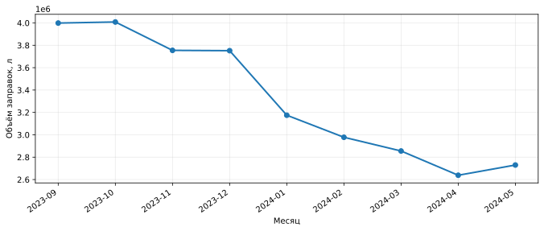
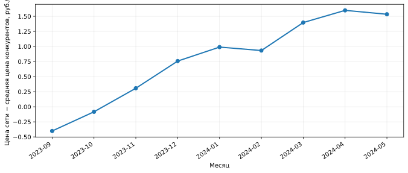
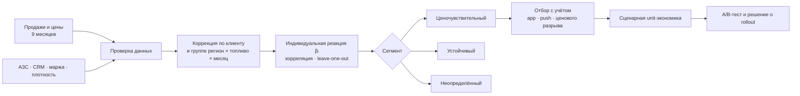

<div align="center">

# ⛽ Fuel Elasticity Lab

### Intelligence Cup · Ретейл и маркетинг · «Эластичность спроса»

**От истории заправок — к проверяемой сегментации, персональным предложениям и измеримому эффекту.**


[**Результаты**](#-ключевые-результаты) · [**Быстрый старт**](#-быстрый-старт) · [**Методология**](docs/methodology.md) · [**Маркетинг**](docs/marketing.md) · [**Экономика**](docs/economics.md) · [**A/B-тест**](docs/experiments.md) · [**План защиты**](docs/team_and_pitch.md)

</div>

---

## 🎯 Какая проблема решается

При одинаковом изменении цены одни автомобилисты продолжают заправляться на привычной АЗС, а другие снижают покупки. В кейсе программы лояльности **«Нам по пути»** требуется выделить ценозависимых клиентов, подобрать релевантные механики удержания и оценить их экономику.

**Гипотеза:** адресный бонус выгоднее массовой скидки, если выдавать его клиентам, которые *вероятно* реагируют на ухудшение ценового положения сети, и если инкрементальный вклад от дополнительных заправок больше всей стоимости бонусов.

> **Научная оговорка:** этот проект выявляет **статистические ассоциации**, а не доказывает причинную ценовую эластичность. Переходы клиентов к конкурентам не наблюдаются. Эффект оффера **сценарный** до проведения A/B-теста.

## 📊 Ключевые результаты

<details open>
<summary><b>Исследовательский анализ исходной выборки за сентябрь 2023 — май 2024</b></summary>

| Показатель | Результат |
|:--|--:|
| Клиенты в основной таблице | **33 146** |
| Основные АЗС | **642** |
| Объём топлива за 9 месяцев | **29,89 млн л** |
| Ценочувствительные (по принятому правилу) | **8 822 · 26,6%** |
| Ценоустойчивые (по принятому правилу) | **10 735 · 32,4%** |
| Реакция не установлена | **13 589 · 41,0%** |
| Подходят под условия пилота в мае 2024 | **3 568** |

**Проверка на отложенных месяцах:** у групп, выделенных по сентябрю–марту, коэффициент реакции в апреле–мае равен **−0,201** (чувствительные) против **−0,040** (устойчивые). Это подтверждает различие в *наблюдаемой связи*, но не причинность.

</details>

### Что происходило с объёмами и ценами





*Положительный разрыв = средняя цена сети выше средней цены конкурентов. Общая нисходящая динамика объёма может иметь причины помимо цены.*

### Сценарная оценка персонального оффера

| Параметр | Значение |
|:--|--:|
| Аудитория пилота | 3 568 клиентов |
| Бонус | 0,50 ₽/л, первые 70 л |
| Допущение о росте объёма | 5% |
| Дополнительные литры | 16 999 л |
| Полные расходы на бонусы | 88 165 ₽ |
| Дополнительный вклад | 169 600 ₽ |
| **Дополнительный результат за модельный месяц** | **+81 435 ₽** |
| Расчётный порог безубыточности | **≈ 2,58% uplift** |

Это **не прогноз гарантированного дохода**: влияние бонуса на заправки пока неизвестно. Подробнее — [экономическая модель](docs/economics.md).

## 🧠 Как это работает



Метод расчёта: [двойная центровка и правила сегментации](docs/methodology.md). Операционная архитектура: [docs/architecture.md](docs/architecture.md).

## 🚀 Быстрый старт

**1. Клонировать проект и установить зависимости**

```bash
git clone <URL-ВАШЕГО-РЕПОЗИТОРИЯ>
cd fuel-elasticity-intelligence-cup
python -m venv .venv
# Linux/macOS: source .venv/bin/activate
# Windows PowerShell: .venv\Scripts\Activate.ps1
python -m pip install -e ".[dev]"
```

**2. Запустить полностью автономный пример — без файла чемпионата**

```bash
fuel-elasticity demo --output outputs/demo --clients 1200 --seed 42
```

Это **синтетические** клиенты. Результаты не следует выдавать за метрики из кейса.

**3. Выполнить настоящий анализ локально**

Поместите `.xlsb` в `data/raw/` (папка исключена из Git) и выполните:

```bash
fuel-elasticity run \
  --input "data/raw/Кейс_Ретейл_и_маркетинг_Дополнительные_данные(1).xlsb" \
  --output outputs/real
```

В PowerShell то же самое можно записать одной строкой:

```powershell
fuel-elasticity run --input "data/raw/Кейс_Ретейл_и_маркетинг_Дополнительные_данные(1).xlsb" --output outputs/real
```

Для выгрузки **только агрегированных результатов** используйте флаг `--public-only`.

**4. Проверить тесты**

```bash
python -m pytest
```

Для перебора допущений оффера:

```bash
fuel-elasticity run --input "data/raw/your_data.xlsb" --output outputs/scenario_1 \
  --rebate 0.5 --cap 70 --uplift 0.05 --price-gap 0.5
```

## 🌐 Как опубликовать на GitHub

Создайте новый **пустой** репозиторий через веб-интерфейс GitHub (без автогенерации README), распакуйте архив и из корня проекта выполните:

```bash
git init -b main
git add .
git status                         # проверьте состав файлов: НЕТ клиентских данных
git commit -m "Initial release: fuel elasticity analysis"
git remote add origin https://github.com/<YOUR_USERNAME>/<YOUR_REPO>.git
git push -u origin main
```

**До `git push` проверьте разрешение организаторов на публикацию агрегированных результатов и материалов кейса.** Если оно не получено, создайте **private**-репозиторий или удалите `reports/summary.json`, `reports/summary.md` и изображения из `reports/figures/` перед публикацией. Исключения `.gitignore` защищают только от обычного `git add`, не от принудительного добавления (`git add -f`).

## 📂 Структура репозитория

```text
fuel-elasticity-intelligence-cup/
├── .github/workflows/ci.yml       # GitHub Actions: тесты и demo
├── data/
│   ├── raw/                        # приватные исходники, игнорируются Git
│   └── README.md                   # политика публикации данных
├── docs/
│   ├── methodology.md              # сегментация и формулы
│   ├── data_dictionary.md          # описание всех шести листов
│   ├── marketing.md                # предложения и клиентский путь
│   ├── economics.md                # маржа, бюджет, breakeven
│   ├── experiments.md              # план A/B-теста
│   ├── architecture.md             # интеграция с CRM и приложением
│   ├── limitations.md              # ограничения, проверки качества
│   └── team_and_pitch.md           # роли команды и план защиты
├── reports/
│   ├── summary.md                  # результаты на реальных агрегатах
│   ├── summary.json                # те же показатели для сервисов
│   └── figures/                    # графики без клиентских ID
├── src/fuel_elasticity/
│   ├── io.py                        # импорт .xlsb
│   ├── model.py                     # структура и контроль данных
│   ├── segmentation.py              # алгоритм сегментации
│   ├── validation.py                # temporal holdout
│   ├── economics.py                 # модель бонусов
│   ├── reporting.py                 # отчёты и графики
│   ├── demo.py                      # полностью синтетический набор
│   └── cli.py                       # командная строка
├── tests/                           # pytest
├── pyproject.toml                   # зависимости + CLI entry point
├── requirements.txt
└── Makefile
```

После запуска создаются `outputs/public/` (обезличенные агрегаты) и, если не передан `--public-only`, `outputs/private/customer_scores.csv` (клиентский скоринг). **Весь `outputs/` исключён из Git.**

## 🎁 Персонализация и путь клиента

| Сегмент | Механика | Зачем |
|---|---|---|
| **Ценочувствительный** | Адресный возврат на ограниченное число литров | Удержать объём, не снижая цену для всех |
| **Ценоустойчивый** | Бонусы за регулярность, СТиУ, сервис | Увеличить ценность без лишних топливных скидок |
| **Неопределённый** | Небольшие рандомизированные тесты | Получить данные о реакции, не делая необоснованных выводов |

**Новый клиентский путь:** мониторинг цен → решение о предложении → автоматическое назначение в лояльности → показ в приложении при наличии согласия → заправка → автоматическое начисление → обновление аналитики. См. [схему пути](docs/marketing.md).

## ⚠️ Ограничения, которые нельзя скрывать

- Наблюдаются покупки в сети, но **нет транзакций на АЗС конкурентов**.
- **473 клиент-месяца** имеют нулевую цену **и сети, и конкурентов**: исторический расчёт интерпретирует их разрыв как ноль ради воспроизводимости, что может смещать коэффициенты. Требуется отдельная проверка чувствительности к пропускам.
- **7 клиентов** из основной таблицы не найдены в CRM; они не могут быть отобраны в push-пилот без подтверждённых разрешений.
- Девять месячных наблюдений — слишком короткий ряд для индивидуальной причинной эластичности. Среднемесячные цены и литры не позволяют увидеть отдельные визиты.
- В формуле маржи предполагается, что указанный OPEX ещё **не вычтен** из «Средней маржи». Это нужно подтвердить у организаторов.
- Сценарный прирост 5% — **допущение**, а не результат эксперимента.

Полный список: [docs/limitations.md](docs/limitations.md).

## 👥 Команда и защита

Для кейса удобно распределить работу между **3–4 участниками**: Data Scientist (сегментация), Data Engineer (данные и воспроизводимость), Product/CRM аналитик (клиентский путь) и экономист/капитан (эффект и A/B). Для 2–3 человек роли можно совместить. Состав и план восьми слайдов: [docs/team_and_pitch.md](docs/team_and_pitch.md).

## ✅ Критерии успеха в пилоте

**Основная бизнес-метрика:** инкрементальный вклад на клиента *после всех бонусов*, включая затраты на тех, кто купил бы топливо без предложения. Вторичные: литры/клиент, реактивация, частота заправок, затраты на бонусы, покупки СТиУ; ограничения: жалобы, отписки, маржинальность и частота коммуникаций.

Рандомизацию следует делать внутри сопоставимых страт, а считать результат по принципу **intention-to-treat**: считать всех назначенных клиентов, даже если они не пришли на АЗС. [План эксперимента →](docs/experiments.md)

---

<sub>Независимый учебно-исследовательский проект по условиям кейса Intelligence Cup. Не является официальным программным продуктом или результатом подтверждённого внедрения «Газпром нефти». Исходные файлы и индивидуальные записи клиентов в публичный репозиторий не включены. Перед публичной публикацией команда должна согласовать право на раскрытие даже агрегированных показателей, материалы кейса и выбранную лицензию на код.</sub>
