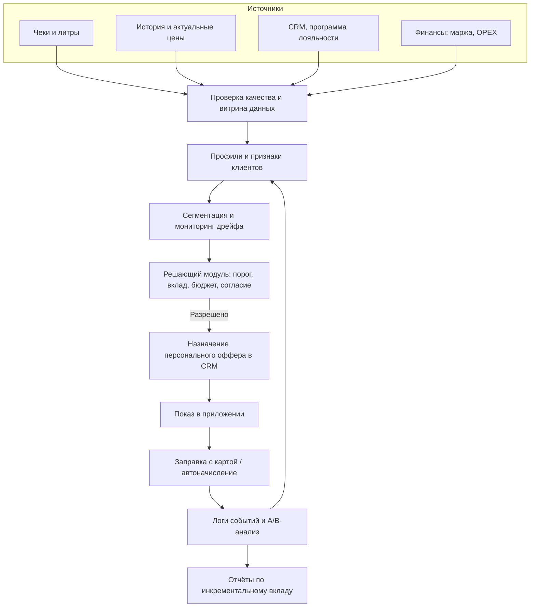

# Техническая архитектура и интеграция с продуктом

[← На главную](../README.md)

Репозиторий реализует **offline аналитический прототип**, а не подключённый к CRM сервис. Ниже — целевая архитектура внедрения, требующая проектирования API, прав доступа и согласия владельцев систем.



## Части MVP

| Компонент | Реализовано в коде | Требуется для производства |
|---|---|---|
| Чтение данных | `.xlsb`-адаптер | Автоматический ETL, права и проверки схемы |
| Feature engineering | Разрыв цен, `ln(1+л)`, двойная центровка | Дневная/событийная гранулярность и мониторинг качества |
| Скоринг | Три сегмента, LOO | Реестр версий, рефит, дрейф и backtesting |
| Ограничение по каналам | Флаги приложения + push из среза | **Онлайн** проверка актуального согласия перед отправкой |
| Финансы | Модель затрат и вклада | Согласованная маржа, лимиты бюджета, учёт внешних промо |
| Интерфейс | Агрегаты JSON/MD/SVG | CRM API, приложение, выплата бонусов, event tracking |
| Измерение | Двухмесячный holdout | Сервис A/B-рандомизации и экспериментов |

## Контракт будущего события назначения

Пример **схемы интеграции**, не действующий API компании:

```json
{
  "event_type": "offer_decision",
  "client_token": "<PSEUDONYM>",
  "station_token": "<STATION_PSEUDONYM>",
  "model_version": "fuel-elasticity-1.0.0",
  "price_gap_rub_per_liter": 0.8,
  "segment": "price_sensitive",
  "eligible": true,
  "offer": {"rebate_rub_per_liter": 0.5, "cap_liters": 70},
  "consent_verified_at_send_time": true,
  "experiment_arm": "treatment"
}
```

Реализация должна включать журнал решений, дедупликацию, TTL предложения, idempotency key, отзыв согласия, мониторинг инцидентов начисления и аудит расходов. Клиентские идентификаторы нельзя включать в открытый лог или публичный GitHub.
