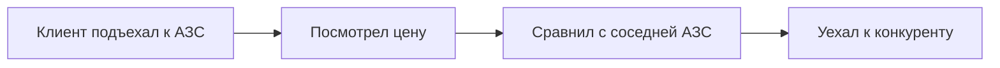
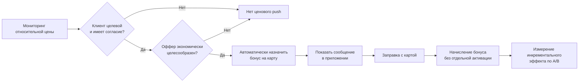

# Маркетинговые механики и новый клиентский путь

[← На главную](../README.md) · [Экономика](economics.md) · [Архитектура](architecture.md)

## От сегмента к предложению

| Целевая аудитория | Предложение | Канал | Защитное ограничение |
|---|---|---|---|
| Ценочувствительные с положительным разрывом | Бонус 0,50 ₽/л, максимум 70 л | Push в приложении + автоприменение по карте | Не чаще 1 пилотного оффера за окно, контроль бюджета |
| Ценочувствительные без подтверждённого канала | Не назначать push, использовать допустимый по согласию канал после юридической проверки | Только разрешённые каналы | Нельзя трактовать отсутствие данных как согласие |
| Ценоустойчивые | Челлендж «3 заправки за месяц», баллы на кофе / мойку | Приложение, только при согласии | Не давать универсальную скидку на топливо |
| Неопределённые | Небольшой эксперимент с предложением, сравнение с контролем | Рандомизированно | Нет автоматического ярлыка «нечувствителен» |

Эти механики предложены **аналитической командой**, не являются действующими правилами программы «Нам по пути».

## Клиентский путь до и после

**Раньше:**

**Предлагаемый путь:**

**Сообщение, пример:** «Для вашей карты действует персональный бонус: +0,50 ₽ за литр на первые 70 литров топлива до [дата]. Начислим автоматически при оплате с картой “Нам по пути”.» При копировании в продукт необходимо проверить, что формулировка соответствует правилам и пользовательским соглашениям. Не обещаем произвольную дополнительную скидку, если она технически не назначена.

## Правила отправки

**В моменте принятия решения** нужны не исторические месячные цены, а актуальная цена АЗС, подтверждённая цена альтернатив в окрестности и действующая политика доступа к этим данным. Месячная выборка чемпионата используется для **исследования**, а не как готовый realtime event stream.

Ограничения коммуникации: действующее согласие, дедупликация, время тихих часов, частотный лимит, отмена после отзыва согласия, безопасная ссылка в приложение, лог назначения и причины решения.

## Метрики пути

Доставлено → показано → активирован бонус в CRM (автоматически) → визит → литры/клиент → стоимость начислений → инкрементальный вклад → долгосрочное удержание. Для измерения причинного вклада сравниваем с рандомизированной контрольной группой, а не только с прошлым месяцем.
